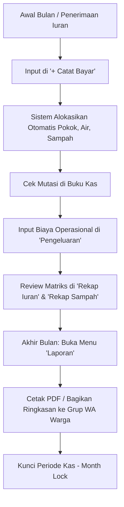

# Panduan Penggunaan Aplikasi Paradessa Household Dues

Selamat datang di panduan resmi penggunaan sistem web **Paradessa Household Dues**, aplikasi pembukuan kas dan pengelolaan iuran warga untuk perumahan **Paradessa Habitat** (Jl. Desa Banda Asri RT.02/RW.09, Desa Pananjung, Kec. Cangkuang, Kab. Bandung, Jawa Barat 40238).

Dokumen ini memuat panduan lengkap mengenai daftar akun pengguna (beserta *username* dan *password*), hak akses masing-masing peran, serta alur penggunaan fitur-fitur utama di dalam aplikasi.

---

## 1. Daftar Akun Pengguna & Kredensial Login

Sistem dilengkapi dengan autentikasi berbasis peran (*role-based access control*). Anda dapat menggunakan akun bawaan (*default*) berikut untuk masuk ke dalam aplikasi:

| Peran (Role) | Username / ID | Alternatif Login (No. WA / Email) | Password | Hak Akses Utama |
| :--- | :--- | :--- | :--- | :--- |
| **Pengurus / Bendahara** *(Admin)* | `bendahara` | `08123456789` `bendahara@paradessa.id` | `paradessa2026` | **Akses Penuh**: Catat Penerimaan Iuran, Catat Pengeluaran, Edit & Hapus Transaksi Buku Kas, Buat/Kunci Laporan Resmi, Manajemen Rumah & Warga, Kelola Talangan, Ubah Tarif Iuran, Tambah/Edit Akun Pengguna. |
| **Warga (Contoh: Blok A1)** *(Resident)* | `warga` | `08129876543` `eko.a1@paradessa.id` | `warga2026` | **Akses Warga**: Melihat transparansi Buku Kas, mengecek status & histori iuran rumah sendiri, melihat rekap iuran dan laporan keuangan bulanan. |

### Susunan Pengurus Paguyuban Paradessa Habitat
- **Rizqi Ahmad Fauzi** — Bendahara Kas Paradessa (Unit: Blok A18)
- **Yanwar Yusuf Rukmana** — Pengurus Paguyuban (Unit: Blok A5)
- **Eko Agung Prabowo** — Pengurus Paguyuban (Unit: Blok A1)

> **Tips Keamanan:**
> - Pengurus/Bendahara dapat menambahkan akun warga baru atau mengubah kata sandi melalui menu **Menu Lainnya > Pengguna** (`/pengguna`).
> - Field username saat login bersifat fleksibel: dapat diisi dengan **Username**, **Nomor WhatsApp**, maupun **Alamat Email** yang terdaftar.

---

## 2. Cara Masuk ke Aplikasi (Login)

1. Buka tautan website aplikasi (misal di Vercel atau `http://localhost:3000` di lingkungan lokal).
2. Jika belum masuk, Anda akan diarahkan ke halaman login (`/login`).
3. Masukkan **Username / No. WA / Email** dan **Password** sesuai tabel di atas.
4. Klik tombol **Masuk ke Sistem**.
5. Sistem akan menyimpan sesi login Anda secara otomatis (sesi aktif hingga 30 hari).
6. Untuk keluar (*logout*), klik nama profil Anda di pojok kanan atas bilah navigasi dan pilih ikon keluar (**Logout**).

---

## 3. Panduan Fitur & Alur Penggunaan

### A. Beranda (Dashboard Keuangan)
Halaman utama yang menyajikan ikhtisar keuangan secara *real-time*:
- **Kartu Ringkasan:** Menampilkan Saldo Kas Saat Ini, Total Pemasukan Bulan Ini, Total Pengeluaran Bulan Ini, dan Tingkat Kepatuhan Pembayaran Iuran (persentase rumah yang sudah lunas di bulan berjalan).
- **Grafik Tren Kas:** Visualisasi perbandingan pemasukan vs pengeluaran selama beberapa bulan terakhir.
- **Aktivitas Terbaru:** Daftar 5 transaksi kas terakhir yang dicatat ke dalam sistem.

---

### B. Catat Pembayaran Iuran Warga (`/pembayaran`)
Menu utama bendahara untuk mencatat setoran iuran dari warga (via transfer bank maupun tunai/cash).

**Fitur Pembayaran Bulan Depan (Bayar di Muka / Prepayment):**
Seringkali ada warga yang sudah mulai membayar iuran untuk bulan depan meskipun masih di periode bulan berjalan (misalnya membayar iuran **November 2026** pada akhir **Oktober 2026**). Sistem menyediakan tombol dan alur khusus untuk skenario ini:
- Klik tombol cepat **"Bayar Bulan Depan (Nov 2026) — Di Muka"**.
- Sistem otomatis menetapkan bulan target ke bulan depan, nominal Rp 120.000, serta mengisi keterangan *"Iuran Bulan November 2026 (Bayar di Muka)"*.
- **Pencatatan Akuntansi Kas:** Uang masuk tetap dicatat pada tanggal uang diterima (masuk ke saldo Buku Kas **Oktober 2026**), namun di matriks status iuran warga, bulan **November 2026** langsung berstatus **Lunas** (*Prepayment*).

**Langkah-langkah Pencatatan:**
1. Klik tombol oranye **+ Catat Bayar** pada bilah navigasi atas.
2. **Pilih Nomor Rumah Warga:** Ketik atau pilih blok rumah (contoh: `A18`, `B38`, `A1`).
3. **Pilihan Target Pembayaran:**
   - **Lunas Bulan Ini:** Membayar tagihan bulan berjalan (misal Oktober 2026).
   - **Bayar Bulan Depan (Di Muka):** Membayar lebih awal untuk bulan berikutnya (misal November 2026).
   - **Otomatis / Urut Tunggakan:** Mengalokasikan dana ke tunggakan tertua yang belum lunas.
   - **Pilih Bulan Spesifik:** Dropdown seluruh bulan dari awal tahun hingga tahun depan.
4. **Nominal Pembayaran:** Masukkan jumlah uang yang diterima (misal Rp 120.000 untuk paket lengkap Pokok + Air + Sampah).
5. **Tanggal & Metode:** Tentukan tanggal penerimaan uang serta metode (Transfer Bank atau Tunai/Cash).
6. **Catatan (Opsional):** Tambahkan berita transfer atau keterangan jika ada.
7. **Periksa Preview Alokasi:**
   - Sistem menampilkan rincian alokasi secara transparan (komponen Pokok Rp 50.000, Air Rp 20.000, Sampah Rp 50.000).
   - Terdapat label status: **Iuran Bulan Berjalan**, **Bayar di Muka (Prepayment)**, atau **Pelunasan Tunggakan**.
8. Klik **Simpan Pembayaran**. Data mutasi langsung masuk ke Buku Kas dan rekap iuran otomatis terupdate.

---

### C. Buku Kas Kontinyu Dinamis (`/buku-kas`)
Buku kas digital yang merefleksikan arus uang masuk dan uang keluar secara otomatis dan berkelanjutan tanpa perlu tutup buku tahunan manual.

**Fitur Unggulan Buku Kas:**
- **Navigasi Periode:** Pilih tahun dan tab bulan (**Januari – Desember**). Tombol panah kiri/kanan memungkinkan navigasi berkesinambungan (misal dari Desember 2025 langsung ke Januari 2026).
- **Saldo Berjalan Otomatis:** Saldo awal tiap bulan otomatis terbawa dari saldo akhir bulan sebelumnya. Setiap ada perubahan pada transaksi masa lalu, saldo bulan-bulan berikutnya otomatis dihitung ulang (*cascade recalculation*).
- **Tombol Segarkan (Refresh):** Terletak di bilah kanan atas tabel. Klik ikon ini kapan saja untuk memuat ulang data mutasi kas terbaru langsung dari server tanpa me-reload browser.
- **Pencarian & Filter:** Saring transaksi berdasarkan kata kunci keterangan, jenis (Semua / Masuk Saja / Keluar Saja), kategori pengeluaran, atau blok rumah tertentu (contoh: `A18`).
- **Mode Tampilan:** Tersedia pilihan tampilan **Bulanan**, **1 Tahun** (rekapitulasi 12 bulan), dan **Multi-Tahun**.
- **Ekspor Data:** Klik tombol **Export Excel** untuk mengunduh mutasi kas dalam format `.xlsx`.

---

### D. Catat Pengeluaran Kas (`/pengeluaran`)
Digunakan oleh bendahara untuk mencatat semua biaya operasional lingkungan perumahan.

**Langkah-langkah Pencatatan:**
1. Klik tombol **Pengeluaran** pada bilah navigasi.
2. Tentukan **Tanggal Transaksi** dan **Kategori Biaya** (misalnya: *Petugas Sampah*, *Kebersihan Lingkungan*, *Listrik & Air Fasum*, *Perbaikan/Maintenance*, *Operasional/ATK*, atau *Lain-lain*).
3. Masukkan **Nominal Pengeluaran (Rp)**.
4. Tulis **Keterangan / Deskripsi** pengeluaran yang jelas (contoh: *"Upah angkut sampah Pak Udin periode Oktober"* atau *"Beli lampu jalan pos satpam 3 pcs"*).
5. Pilih metode pembayaran kas (Transfer / Tunai).
6. Klik **Simpan Pengeluaran**. Saldo kas akan otomatis terpotong pada Buku Kas periode tersebut.

---

### E. Rekap Iuran Warga (`/rekap-iuran`)
Menampilkan matriks komprehensif status pembayaran seluruh unit rumah (29 unit rumah) dari bulan Januari hingga Desember.

**Indikator Warna Status:**
- 🟩 **Hijau (Lunas):** Iuran bulan tersebut sudah dibayar penuh (Rp 120.000).
- 🟨 **Kuning (Sebagian):** Pembayaran telah masuk sebagian (misal baru Pokok/Air saja).
- 🟥 **Merah (Belum Bayar):** Tagihan belum dibayar atau masih tertunggak.
- ⬜ **Abu-abu (Tidak Ikut/Kosong):** Rumah kosong atau unit belum dihuni.
- Klik pada sel rumah & bulan tertentu untuk melihat modal detail histori alokasi pembayaran.

---

### F. Rekap Iuran Sampah (`/rekap-sampah`)
Monitoring khusus komponen retribusi sampah (Rp 50.000/rumah):
- Memantau berapa unit rumah yang aktif berlangganan iuran sampah pada bulan tersebut.
- Melakukan rekonsiliasi otomatis antara total uang sampah yang terkumpul dari warga dengan realisasi pembayaran upah ke petugas sampah (Pak Udin).

---

### G. Laporan Bulanan Resmi & Cetak (`/laporan`)
Membuat lembar Laporan Pertanggungjawaban Keuangan Bulanan siap saji dengan format standar resmi pengurus paguyuban Paradessa Habitat:
- **Header Resmi:** Kop alamat perumahan dan judul *"LAPORAN KEUANGAN KAS WARGA PARADESSA HABITAT"*.
- **Tabel Transaksi:** Rincian kronologis nomor, tanggal, jenis transaksi, keterangan, masuk, keluar, dan saldo berjalan.
- **Ringkasan Kas:** Rekapitulasi Saldo Awal, Total Pemasukan, Total Pengeluaran, dan Saldo Akhir periode.
- **Aksi Cepat:**
  - **Cetak / Unduh PDF:** Menghasilkan dokumen cetak dengan format layout rapi dan kolom tanda tangan Bendahara.
  - **Salin Teks Ringkasan:** Menyalin ringkasan laporan kas ke clipboard komputer/ponsel.
  - **Bagikan ke WhatsApp:** Membuka pesan WhatsApp terformat otomatis untuk dibagikan ke grup warga Paradessa.
  - **Kunci Laporan (*Month Lock*):** Mengunci buku kas bulan tersebut agar tidak dapat diubah tanpa persetujuan pengurus.

---

### H. Data Rumah & Warga (`/rumah`)
Katalog data warga dan unit rumah di lingkungan perumahan:
- Menampilkan seluruh unit blok rumah (Blok A1 s/d B38) beserta nama pemilik/penghuni, nomor kontak WhatsApp, dan status huni.
- Klik salah satu rumah untuk membuka profil detail: melihat riwayat pembayaran kumulatif rumah tersebut, catatan tunggakan, serta menerbitkan **Surat Tagihan Iuran Warga** yang dapat langsung dikirim via WhatsApp.

---

### I. Talangan / Kasbon Warga (`/talangan`)
Pencatatan dana talangan fasilitas perumahan yang dibayarkan terlebih dahulu oleh salah satu warga:
- Mencatat tanggal talangan, nama warga penyedia dana, nominal, dan peruntukan dana.
- Opsi pelunasan talangan: dapat diganti langsung via kas tunai/transfer, atau dikompensasikan dengan pemotongan iuran bulanan rumah warga yang bersangkutan.

---

### J. Pengaturan Sistem (`/pengaturan`)
Dikhususkan bagi Bendahara untuk mengonfigurasi parameter sistem:
- **Komponen Tarif Iuran Bulanan:** Pengaturan nominal default (saat ini: Pokok Rp 50.000, Air Rp 20.000, Sampah Rp 50.000 = Total Rp 120.000/bulan).
- **Saldo Awal Pembukuan:** Mengatur saldo modal awal saat sistem pertama kali dioperasikan.
- **Informasi Paguyuban:** Nama perumahan, nomor RT/RW, dan nama bendahara yang bertanda tangan di laporan.

---

## 4. Standar Operasional Prosedur (SOP) Bulanan Bendahara

Untuk menjaga keteraturan dan akurasi buku kas perumahan, disarankan mengikuti alur rutin berikut setiap bulan:

1. **Awal hingga Pertengahan Bulan:**
   - Setiap ada warga yang transfer atau bayar tunai, segera input melalui menu **+ Catat Bayar**.
   - Periksa apakah bulan yang dipilih sudah sesuai (pilihan bulan target membantu mencegah salah alokasi).
2. **Saat Ada Pengeluaran:**
   - Catat setiap pengeluaran kas (kebersihan, sampah, perbaikan fasilitas) melalui menu **Pengeluaran**.
3. **Pengecekan Rutin:**
   - Buka menu **Buku Kas** dan gunakan tombol **Segarkan** untuk memastikan saldo fisik di rekening bank/kas tunai cocok dengan saldo berjalan di sistem.
   - Buka menu **Rekap Iuran** untuk memantau rumah mana saja yang belum melunasi kewajiban iuran bulan berjalan.
4. **Akhir Bulan:**
   - Buka menu **Laporan**, periksa kebenaran seluruh saldo awal, total pemasukan, dan total pengeluaran.
   - Klik **Bagikan ke WhatsApp** untuk mengirim laporan transparansi kepada warga.
   - Klik **Kunci Laporan** untuk mengarsipkan pembukuan bulan tersebut.

---

## 5. Pertanyaan Umum & Bantuan (FAQ)

**Q: Apa yang terjadi jika warga membayar lebih besar dari nominal tagihan (misal Rp 240.000)?**  
*A:* Sistem secara otomatis akan mengalokasikan kelebihan dana tersebut untuk membayar tagihan bulan berikutnya (*prepayment*), sehingga status iuran warga untuk bulan depan langsung otomatis menjadi lunas.

**Q: Warga membayar dengan nomor rekening berbeda atau titip tetangga, bagaimana mencatatnya?**  
*A:* Tetap pilih blok rumah warga yang bersangkutan di dropdown nomor rumah, lalu pada kolom *"Nama Pembayar / Pengirim"* isikan nama orang yang mentransfer beserta catatan di kolom keterangan.

**Q: Apakah data tersimpan aman jika aplikasi ditutup atau perangkat berganti?**  
*A:* Ya, semua data transaksi, profil warga, dan konfigurasi tersimpan secara terpusat di cloud database (Turso). Anda dapat mengakses aplikasi dari laptop, tablet, maupun smartphone dengan data yang selalu tersinkronisasi secara *real-time*.

---
*Dokumen ini disusun untuk Paguyuban Warga Paradessa Habitat.*

